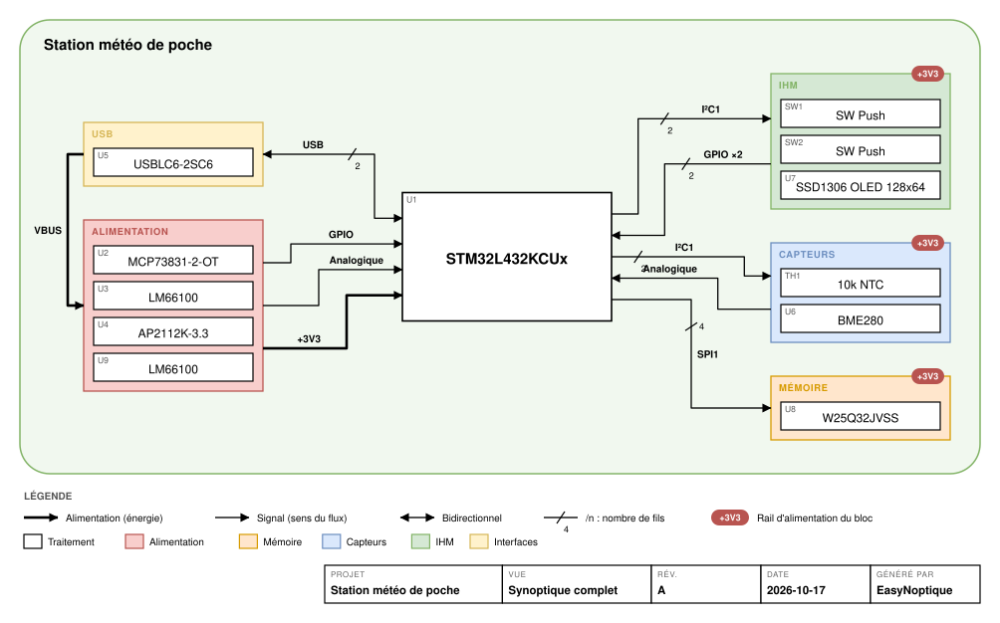

# EasyNoptique

Génère automatiquement les **synoptiques** d'un projet KiCad : vue fonctionnelle, arbre d'alimentation et vue des bus.
Les sorties sont en SVG, **draw.io** (retouchable, un calque par type de liaison), rapport HTML interactif et JSON.



*Exemple généré à partir de [`tests/fixtures/meteo-poche.xml`](tests/fixtures/meteo-poche.xml) (carte fictive).
Autres vues : [alimentation](docs/exemple/station-meteo-de-poche-alimentation.svg) ·
[bus](docs/exemple/station-meteo-de-poche-bus.svg) · [fichier draw.io](docs/exemple/station-meteo-de-poche.drawio).*

> **État : prototype (v0.1).** Le cœur (analyse, placement, exports) fonctionne et est testé. Le plugin KiCad
> est testé avec un KiCad simulé ; il reste à le valider dans un vrai KiCad. Voir [ROADMAP.md](ROADMAP.md).

## Installation dans KiCad (plugin)

1. Téléchargez [`release/EasyNoptique-0.2.0-kicad.zip`](release/EasyNoptique-0.2.0-kicad.zip) (bouton « Download raw file »).
2. Dans KiCad : **Gestionnaire de plugins et de contenus** → **Installer depuis un fichier…** → choisissez le `.zip`.
3. Ouvrez votre circuit dans l'**éditeur de PCB**. Un bouton EasyNoptique apparaît dans la barre d'outils
   (sinon : **Outils → Outils externes → Actualiser les plugins**).
4. Cliquez dessus : les synoptiques sont écrits dans le dossier `synoptique/` du projet et le rapport s'ouvre
   dans le navigateur.

Le plugin lit le PCB ouvert : pensez à le mettre à jour depuis le schéma (**F8**) avant. Il fonctionne de
KiCad 6 à 9 avec le Python fourni par KiCad, sans rien installer d'autre.

## Installation en ligne de commande (optionnel)

```bash
pip install -e .            # depuis ce dépôt, Python 3.8 ou plus
```

La ligne de commande lit le schéma via `kicad-cli` (KiCad 7 ou plus). S'il n'est pas trouvé automatiquement,
indiquez son chemin dans la variable `KICAD_CLI`.

## Utilisation en ligne de commande

```bash
easynoptique analyse  mon-projet.kicad_pro     # ce qui a été détecté (blocs, liaisons, alim, alertes)
easynoptique render   mon-projet.kicad_pro     # génère tout dans mon-projet/synoptique/
easynoptique render   mon-projet.kicad_pro -f drawio,svg --views fonctionnel,alimentation
easynoptique dump     mon-projet.kicad_pro     # composants et nets bruts
```

On peut aussi passer une netlist déjà exportée (`kicad-cli sch export netlist --format kicadxml`).

## Comment les liaisons sont détectées

1. **Lecture** de la netlist KiCad XML : composants (feuille, champs) et nets (broches, `pinfunction`, `pintype`).
2. **Blocs** : un bloc par feuille hiérarchique. Le champ `EN_Bloc` sur un composant force son bloc.
   Dans un schéma à plat, chaque circuit intégré devient un bloc.
3. **Tri des nets** : masse (ignorée), alimentation (symboles power, noms `+3V3`, `VBUS`…, broches `power_out`), signal.
4. **Fusion à travers les passifs série** (R, L, ferrite à 2 broches entre deux signaux) : `MCU → R 33 Ω → connecteur` = une liaison.
5. **Liaisons** : un net qui touche des composants actifs de deux blocs différents.
6. **Bus** reconnus par les fonctions de broches du MCU (`I2C1_SDA`, `SPI2_MOSI`, `USART2_TX`…), puis par les noms
   de nets et de broches (`SDA/SCL`, `MOSI/MISO/SCK/CS`, `D+/D−`, `CANH/CANL`, `SWDIO/SWCLK`…). Le reste devient `GPIO`.
7. **Sens des flèches** : protocole (maître → esclave) ou types de broches (`output` → `input`).
8. **Alimentation** : un composant avec `power_in` sur un rail A et `power_out` sur un rail B est un convertisseur A → B.

### Champs KiCad reconnus

| Champ | Rôle | Exemple |
|---|---|---|
| `EN_Bloc` | force le bloc du composant | `Capteurs` |
| `I2C_ADDR` / `EN_Adresse` | adresse affichée dans la vue bus, contrôle des conflits | `0x76` |
| `Courant` / `EN_Courant` | consommation pour le bilan du rail | `12mA` |
| `EN_Imax` | courant max d'un régulateur (taux de charge) | `600mA` |

### Fichier de règles

Les corrections se font dans `mon-projet.easynoptique.yaml`, à côté du projet :

```yaml
hub: mcu                      # bloc central
components:
  U5: {block: usb}            # change le bloc d'un composant
blocks:
  capteurs: {name: "Capteurs env.", category: sensors}
  debug: {hide: true}
nets:
  FLASH_CS: spi               # force le type de bus
ignore_nets: [NRST]
connecteurs: true             # affiche les connecteurs (masqués par défaut)
```

Par défaut, les **connecteurs** (références `J`, `P`, `CN`…) sont retirés des synoptiques ; un bloc qui ne
contient que des connecteurs disparaît. Ils restent affichés comme **sources d'énergie** dans l'arbre
d'alimentation (prise USB, batterie…).

## Conventions de dessin

Inspirées de l'IEC 61082-1 (documents électrotechniques) et de l'ISO 7200 (cartouche) :
lecture de gauche à droite, un trait par bus avec le nombre de fils (`/4`), flèche simple pour le sens du flux,
double flèche pour le bidirectionnel, trait épais pour l'énergie, pointillés pour la programmation, pastille
pour le rail qui alimente un bloc, couleurs par fonction (palette draw.io) avec légende et cartouche systématiques.

## Développement

```bash
pip install -e ".[dev]"
pytest
ruff check easynoptique tests
python tests/fixtures/make_meteo.py   # régénère la netlist d'exemple
```

Architecture : `netlist.py` (lecture) → `analyze.py` (modèle) → `layout.py` (placement) →
`render_svg.py` / `render_drawio.py` / `report.py` (exports). `kicad_board.py` lit le PCB ouvert dans KiCad.
`kicad_plugin/` contient le plugin de l'éditeur de PCB (et `kicad_plugin/ipc/`, une variante pour l'API IPC de
KiCad 9) ; `python tools/build_pcm.py` construit le `.zip` à installer.
